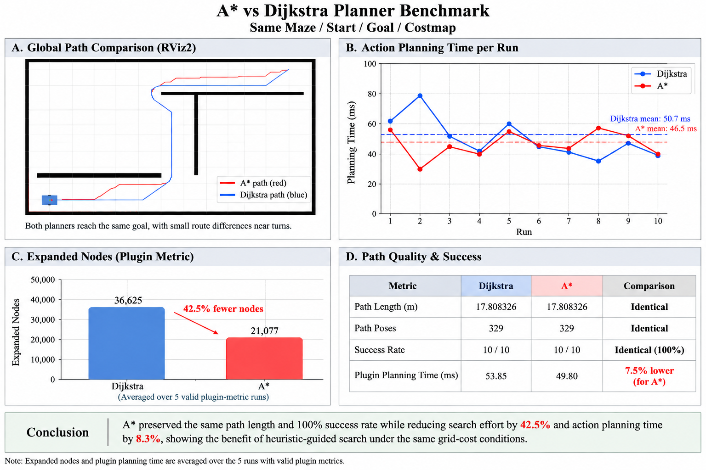
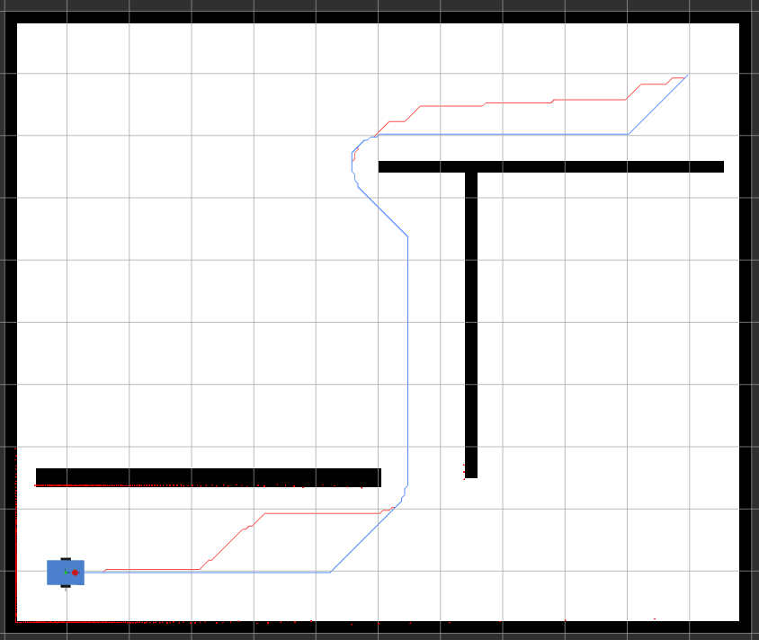
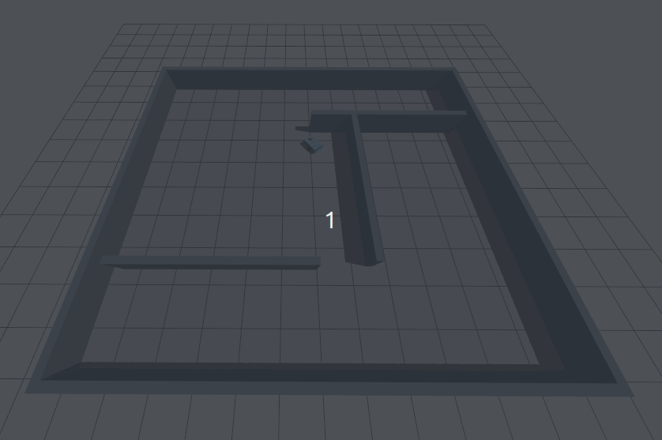
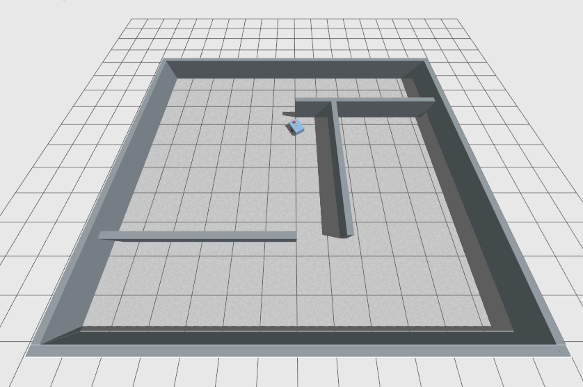

# ROS2 AMR Navigation

ROS2 Humble 기반의 차동구동 AMR Navigation 프로젝트입니다.  
Gazebo 시뮬레이션 환경에서 기존 ICP/EKF Localization을 사용하고, **Dijkstra와 A\***를 직접 구현하여 **Nav2 Global Planner Plugin**으로 통합한 뒤 동일 조건에서 성능을 비교했습니다.

> **Repository name:** `ros2_amr_navigation`



---

## 1. 프로젝트 개요

이 프로젝트의 목적은 동일한 Navigation 환경에서 **heuristic 유무가 Global Path Planning 성능에 미치는 영향**을 확인하는 것입니다.

```text
Dijkstra
f(n) = g(n)

A*
f(n) = g(n) + h(n)
```

A*에는 8-connected grid에 적합한 **Octile distance heuristic**을 적용했습니다.

비교 조건은 다음과 같이 통제했습니다.

- 동일한 Gazebo Maze
- 동일한 Occupancy Grid / Global Costmap
- 동일한 Start / Goal
- 동일한 Robot Model
- 동일한 ICP/EKF Localization
- 동일한 DWB Controller
- 동일한 8-connected neighbor 규칙
- 동일한 obstacle / corner-cut / inflation-cost 처리
- **Planner의 heuristic 사용 여부만 변경**

---

## 2. 주요 결과

Benchmark 조건:

```text
Start       : (0.0, 0.0) [map frame]
Goal        : (10.0, 8.0) [map frame]
Iterations  : 10 / planner
```

| Metric | Dijkstra | A* | 비교 |
|---|---:|---:|---:|
| Success | 10 / 10 | 10 / 10 | 동일 |
| Mean Action Planning Time | 50.7 ms | **46.5 ms** | **A* 8.3% 감소** |
| Mean Expanded Nodes* | 36,625 | **21,077** | **A* 42.5% 감소** |
| Mean Plugin Planning Time* | 53.85 ms | **49.80 ms** | **A* 7.5% 감소** |
| Path Length | 17.808326 m | 17.808326 m | 동일 |
| Path Poses | 329 | 329 | 동일 |

\* `plugin_planning_ms`와 `expanded_nodes`는 metrics topic과 action result가 정상적으로 pair된 **5개 유효 run**의 평균입니다. `action_planning_ms`, path length, success는 전체 10회 결과를 사용했습니다.

### 결과 해석

- 두 Planner 모두 **10/10 경로 생성 성공**
- 두 Planner의 **Path Length와 Pose 수는 동일**
- A*는 Dijkstra보다 **Expanded Nodes를 약 42.5% 감소**
- 전체 Nav2 planning action 기준 평균 시간도 A*가 **약 8.3% 짧음**
- 같은 경로 품질을 유지하면서 A*의 heuristic이 탐색 범위를 줄이는 효과를 확인

---

## 3. RViz2 Global Path 비교



RViz2 설정에서 Path 색상은 다음과 같습니다.

- **A\***: Red (`255, 80, 80`) — `/benchmark/astar_path`
- **Dijkstra**: Blue (`80, 140, 255`) — `/benchmark/dijkstra_path`

두 Planner는 동일한 Start와 Goal에 도달하며, grid 상의 동률 경로 선택에 따라 일부 구간에서 경로 형상이 달라질 수 있습니다. 이번 Benchmark에서는 최종 path length와 pose count가 동일하게 측정되었습니다.

---

## 4. 시스템 구성

```text
                         Gazebo Fortress
                    Maze World + AMR Model
                              |
                  +-----------+-----------+
                  |           |           |
                /scan       /odom       /imu
                  |           |           |
                  v           +-----+-----+
             Custom ICP             |
             scan-to-map            v
                  |             Custom EKF
             map -> odom         fused pose
                  |
                  +-------------------------------+
                                                  |
                                                  v
                                                Nav2
                                           Global Costmap
                                                  |
                                  +---------------+---------------+
                                  |                               |
                                  v                               v
                           Custom Dijkstra                   Custom A*
                              h(n)=0                     Octile heuristic
                                  |                               |
                                  +---------------+---------------+
                                                  |
                                            nav_msgs/Path
                                                  |
                                         Same DWB Controller
                                                  |
                                               /cmd_vel
                                                  |
                                                  v
                                             Gazebo AMR
```

RViz2에서는 다음 항목을 확인할 수 있습니다.

- Occupancy Map
- Robot Model
- TF
- LaserScan
- Global / Local Costmap
- A* / Dijkstra Global Path

---

## 5. Custom Global Planner 구현

### 공통 Grid Search Engine

두 Planner는 별도 알고리즘 코드를 중복 작성하지 않고 공통 검색 엔진을 사용합니다.

```text
src/amr_global_planners/src/grid_search.cpp
```

```text
runGridSearch()
        |
        +-- use_heuristic = false --> Dijkstra
        |
        +-- use_heuristic = true  --> A*
```

공통 구현 항목:

- Nav2 `Costmap2D` 입력
- 8-connected grid search
- straight cost = `1.0`
- diagonal cost = `sqrt(2)`
- obstacle filtering
- corner-cut prevention
- inflation-cost penalty
- `std::priority_queue` Open List
- `g_score`
- closed set
- parent index 기반 path reconstruction

### Dijkstra

```text
src/amr_global_planners/src/dijkstra_planner.cpp
```

```text
use_heuristic = false
```

### A*

```text
src/amr_global_planners/src/astar_planner.cpp
```

```text
use_heuristic = true
```

Octile heuristic:

```text
h = min(dx, dy) * sqrt(2)
  + (max(dx, dy) - min(dx, dy))
```

두 Planner는 `nav2_core::GlobalPlanner`를 구현하고 `pluginlib`을 통해 Planner Server에 등록됩니다.

```text
src/amr_global_planners/global_planner_plugin.xml
```

---

## 6. Navigation Environment

Gazebo World:

```text
src/amr_navigation_bringup/worlds/maze_world.sdf
```

Navigation Map:

```text
src/amr_navigation_bringup/maps/maze_map.pgm
src/amr_navigation_bringup/maps/maze_map.yaml
```

Maze World와 Occupancy Map은 동일한 wall definition으로 생성됩니다.

```text
src/amr_navigation_bringup/scripts/generate_maze_assets.py
```

이를 통해 Gazebo collision geometry와 Nav2 map geometry의 불일치를 최소화했습니다.

---

## 7. DWB Corner-Stuck Troubleshooting

초기 실험에서는 A*가 Global Path를 정상 생성했음에도 특정 코너에서 로봇이 CW/CCW 미세 회전을 반복하고 진행하지 못하는 문제가 있었습니다.

### Before



관찰한 `/cmd_vel`:

```text
linear.x  = mostly 0.0, occasionally ~0.0143 m/s
angular.z = mainly ~±0.0316 rad/s
```

A* Path는 정상 생성되었지만 실제 이동량이 부족해 약 15초 후 Nav2에서:

```text
Failed to make progress
```

가 발생했습니다.

수동 `/cmd_vel` 테스트에서 전진과 회전이 정상 동작했기 때문에 Gazebo DiffDrive와 command bridge 문제는 배제했습니다.

DWB가 지나치게 작은 velocity sample을 반복 선택하는 것을 확인하여 다음 값을 조정했습니다.

```yaml
min_speed_xy: 0.05
min_speed_theta: 0.10
```

### After



수정 후 DWB가 최대 약 `±0.1579 rad/s` 수준의 의미 있는 회전 명령을 생성했고, 약 5초간 heading을 정렬한 뒤 코너를 빠져나와 Goal까지 정상 주행했습니다.

이 문제는 **Global Planner 실패가 아니라 Local Controller velocity sampling / progress 문제**로 분리해 확인했습니다.

---

## 8. Repository Structure

```text
ros2_amr_navigation/
├── README.md
├── src/
│   ├── amr_global_planners/
│   │   ├── include/amr_global_planners/
│   │   │   ├── grid_search.hpp
│   │   │   ├── astar_planner.hpp
│   │   │   └── dijkstra_planner.hpp
│   │   ├── src/
│   │   │   ├── grid_search.cpp
│   │   │   ├── astar_planner.cpp
│   │   │   └── dijkstra_planner.cpp
│   │   └── global_planner_plugin.xml
│   │
│   └── amr_navigation_bringup/
│       ├── config/
│       ├── launch/
│       ├── maps/
│       ├── rviz/
│       ├── scripts/
│       └── worlds/
│
├── results/
│   ├── planner_benchmark.csv
│   ├── rviz_astar_dijkstra_path_comparison.png
│   └── astar_dijkstra_planner_benchmark.png
│
├── docs/
│   └── troubleshooting/
│       ├── astar_stuck_in_corner_before_fix.gif
│       └── astar_stuck_in_corner_after_fix.gif
│
└── tools/
    └── import_existing_localization.sh
```

`build/`, `install/`, `log/`, `.vscode/`는 Git에서 제외합니다.

---

## 9. Prerequisite Localization

Navigation 실행에는 기존 Localization 패키지의 다음 세 package가 필요합니다.

```text
robot_description
icp_localization
ekf_localization
```

Source repository:

```text
https://github.com/leejuheon06/ros2-icp-ekf-localization
```

Clone 후 현재 workspace에 import합니다.

```bash
cd ~
git clone https://github.com/leejuheon06/ros2-icp-ekf-localization.git

cd ~/ros2_amr_navigation
./tools/import_existing_localization.sh ~/ros2-icp-ekf-localization
```

이 세 package는 본 repository에서 중복 관리하지 않으며 `.gitignore`에 포함되어 있습니다.

---

## 10. Build

### Environment

- Ubuntu 22.04
- ROS2 Humble
- C++17
- Gazebo Fortress / `ros_gz`
- RViz2
- Nav2

필요 package 설치:

```bash
sudo apt update
sudo apt install -y \
  ros-humble-navigation2 \
  ros-humble-nav2-bringup \
  ros-humble-ros-gz \
  ros-humble-rviz2 \
  python3-matplotlib
```

Dependency 설치 및 build:

```bash
cd ~/ros2_amr_navigation
source /opt/ros/humble/setup.bash

rosdep install \
  --from-paths src \
  --ignore-src \
  -r -y

colcon build --symlink-install
source install/setup.bash
```

Package 확인:

```bash
colcon list
```

예상 package:

```text
amr_global_planners
amr_navigation_bringup
robot_description
icp_localization
ekf_localization
```

---

## 11. Run

### A* Navigation

```bash
source ~/ros2_amr_navigation/install/setup.bash
ros2 launch amr_navigation_bringup maze_astar.launch.py
```

### Dijkstra Navigation

```bash
source ~/ros2_amr_navigation/install/setup.bash
ros2 launch amr_navigation_bringup maze_dijkstra.launch.py
```

A*와 Dijkstra 실행에서 Robot, Localization, Costmap, Controller, Maze는 동일하고 Global Planner만 변경됩니다.

---

## 12. Benchmark Reproduction

```bash
source ~/ros2_amr_navigation/install/setup.bash
ros2 launch amr_navigation_bringup maze_benchmark.launch.py
```

결과:

```text
results/planner_benchmark.csv
```

CSV 주요 항목:

| Field | Description |
|---|---|
| `action_planning_ms` | Nav2 `ComputePathToPose` action 전체 planning 시간 |
| `plugin_planning_ms` | Custom planner 내부에서 측정한 search 시간 |
| `expanded_nodes` | Search 과정에서 확장한 grid node 수 |
| `result_path_length_m` | Nav2 action result path 길이 |
| `result_pose_count` | Path pose 개수 |
| `success` | Path 생성 성공 여부 |

Plot 생성:

```bash
ros2 run amr_navigation_bringup plot_benchmark.py \
  ~/ros2_amr_navigation/results/planner_benchmark.csv
```

---

## 13. 핵심 구현 파일

| File | Role |
|---|---|
| `src/amr_global_planners/src/grid_search.cpp` | Dijkstra / A* 공통 Grid Search |
| `src/amr_global_planners/src/astar_planner.cpp` | A* Nav2 Global Planner Plugin |
| `src/amr_global_planners/src/dijkstra_planner.cpp` | Dijkstra Nav2 Global Planner Plugin |
| `src/amr_global_planners/global_planner_plugin.xml` | Pluginlib 등록 |
| `src/amr_navigation_bringup/config/nav2_astar_params.yaml` | A* Navigation 설정 |
| `src/amr_navigation_bringup/config/nav2_dijkstra_params.yaml` | Dijkstra Navigation 설정 |
| `src/amr_navigation_bringup/config/nav2_benchmark_params.yaml` | 동일 조건 Benchmark 설정 |
| `src/amr_navigation_bringup/scripts/planning_benchmark.py` | 반복 측정 및 CSV 저장 |
| `src/amr_navigation_bringup/scripts/plot_benchmark.py` | Benchmark 결과 시각화 |
| `src/amr_navigation_bringup/rviz/maze_navigation.rviz` | RViz2 표시 설정 |

---

## 14. 결론

동일한 Maze / Start / Goal / Costmap 조건에서 Dijkstra와 A*를 비교한 결과:

- 두 Planner 모두 **100% 경로 생성 성공**
- **Path Length와 Path Pose 수는 동일**
- A*는 Dijkstra 대비 **Expanded Nodes를 약 42.5% 감소**
- A*의 평균 Action Planning Time은 **약 8.3% 감소**

따라서 이번 환경에서는 A*의 heuristic이 **경로 품질을 유지하면서 탐색량을 줄이는 데 효과적**임을 확인했습니다.
